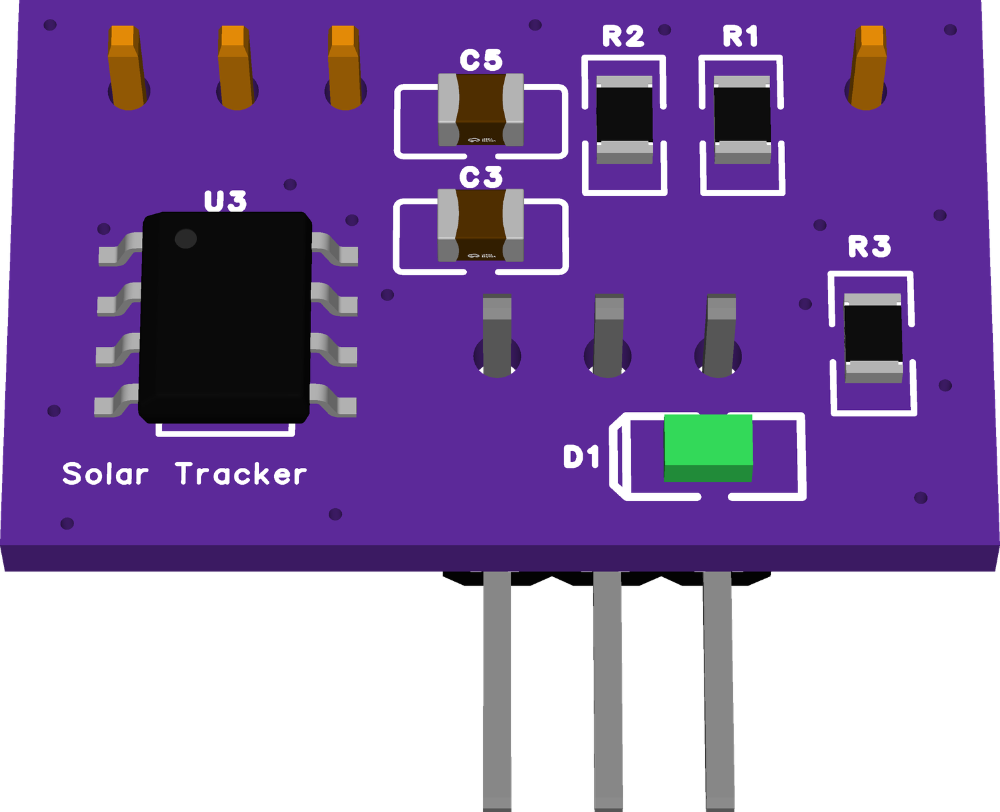
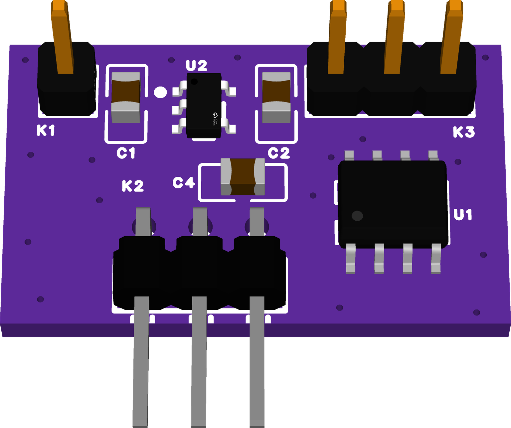

# Solar MPPT FOCV Tracker

Implementation of a Fractional Open Circuit Voltage (FOCV) Solar Tracker for my CN3722 Solar MPPT charge controller, which was (like most analog charger ICs) only tracking a fixed input voltage. Tracking is done by an ATTiny412 microcontroller and an MCP4151 digital potentiometer instead of the precision potentiometer on the circuit board.



*Render of the 3D model, not a photo. Copper is not shown.*

See the following website for further details:

https://www.maltepoeggel.de/?site=solar-mppt-focv

## Status

| Part | State |
|---|---|
| PCB | Designed in EasyEDA Pro, DRC clean, not yet manufactured |
| Firmware | Builds and passes host tests, not yet run on this board |



## Features

- Replaces the precision potentiometer of a CN3722 charger module
- Measures the panel open-circuit voltage every 2 seconds and sets the charger to 80% of it
- Runs from the panel input through a 5 V LDO
- Status LED, UPDI programming header

## Specifications

| Item | Value |
|---|---|
| Board | 22.73 × 13.92 mm, 2 layers, 1.6 mm |
| Input | 7 V to 28 V, including panel VOC at low temperature |
| MCU | ATtiny412 at 8 MHz |
| Digital potentiometer | MCP4151, 100 kΩ, 257 steps |
| ADC range | 27.8 V full scale, 18 kΩ / 3.3 kΩ divider, 4.3 V reference |
| Mounting | Bottom side faces the charger module, right-angle header K2 past the bottom edge |
| K2 pins | Pin 1 wiper, pins 2 and 3 GND; viewed from the top, GND, GND, wiper from left to right |

## Wiring

ATtiny412 (8-pin), see `src/pins.h`:

| ATtiny412 pin | Function          | Connects to                                    |
|----------------|-------------------|-------------------------------------------------|
| PA0            | UPDI              | Programmer (xplainedmini_updi / atmelice_updi)  |
| PA1            | `PIN_POT_DA`       | MCP4151 SDI (SPI data)                          |
| PA2            | `PIN_POT_CS`       | MCP4151 CS                                      |
| PA3            | `PIN_POT_CLK`      | MCP4151 SCK                                     |
| PA6            | `PIN_LED` / UART TX | Status LED, or debug serial TX (see below)     |
| PA7            | `ADC_INP_VOLT`     | Panel voltage divider (18K / 3.3K) tap          |

The regulator must be the 5V `MCP1804T-5002I/OT` (C625416): the 4.3V ADC
reference and the 8MHz clock both depend on a 5V VDD. Panel VOC, including at
low temperature, must stay below 28V (MCP1804 operating limit; the ADC also
saturates near 27.75V).

PA6 is shared between the status LED and the debug UART TX line because
the 8-pin ATtiny412 has no free pin for a dedicated debug output — hence
`ENABLE_DEBUG` and the LED are mutually exclusive at build time.

## Build-time options (`src/main.cpp`)

Both are disabled by default; uncomment the `#define` to enable:

- `ENABLE_VMPP_LOOKUP` — derive the potentiometer position for VMPP from
  the precomputed `vmpp_table` (`src/vmpp.h`) instead of the default
  iterative regulation loop. Useful for a faster single-shot response,
  at the cost of accuracy between table entries.
- `ENABLE_DEBUG` — print `VOC;VMPP[;steps];` over UART (9600 baud) on
  PA6 instead of driving the status LED.

## Calibration constants

- `ADC_MAX_MV` (`src/adc.h`) — input voltage corresponding to a
  full-scale ADC reading, derived from the 18K/3.3K input voltage
  divider and the 4.3V internal ADC reference:
  `4.3V * (18K + 3.3K) / 3.3K ≈ 27.75V`. Re-derive this if the divider
  resistors or ADC reference change, and verify against a multimeter.
- `K_PERCENT` (`src/main.cpp`) — ratio of VMPP to VOC for the panel in
  use (80% is a common default for crystalline silicon panels).
- `ADC_DELAY_MS` (`src/main.cpp`) — settling time after a potentiometer
  step before the ADC is read; must be long enough for the panel/input
  capacitance to settle, particularly when measuring VOC with the load
  removed. Verify with a scope if the panel or cabling changes.
- `VOC_MIN_MV` (`src/main.cpp`) — minimum valid VOC reading; below this,
  the input is treated as disconnected/dark and charging is left disabled.
  Set to 7V because the MCP1804 5V regulator is specified for VIN >= 7V.
- `VMPP_DEADBAND_MV` (`src/main.cpp`) — tolerance band around VMPP
  within which the regulation loop leaves the potentiometer alone, to
  avoid dithering by one step every cycle once converged.

The iterative regulator stops when it reaches the deadband or crosses the
target between adjacent potentiometer positions. On crossing, it holds the
position with the smaller measured voltage error (ties keep the previous
position). Each new VOC measurement starts a fresh search.

`MEAS_DELAY_MS` sets the total measurement-cycle period, including VOC
settling, ADC reads and regulation. Only the remaining time is spent waiting;
an overrun starts the next cycle without an additional delay.

## Ordering

Files are in [`release/rev1`](release/rev1). Upload `gerber-rev1.zip` and send this instruction:

```text
5PCS, FR4, 2 LAYERS, 1.6MM, 1OZ, Purple Soldermask, White Legend, ENIG, TENTED VIAS, order number will be added
```

| Item | Reason |
|---|---|
| 1.6 mm, 1 oz | Standard two-layer stack-up; the stack-up is not stored in the Gerbers |
| ENIG | Flat pads for 0805 and SOIC parts on both sides |
| Smallest features | 0.25 mm tracks, 0.15 mm clearance, 0.3 mm via drill, 0.6 mm via pad |
| Stencil | Needed for each side if the board is reflowed at home |

Open items are listed in the [release notes](release/rev1/README.md).

## Bill of materials

See [`release/rev1/BOM.md`](release/rev1/BOM.md).

## Repository

| Path | Content |
|---|---|
| [`release/rev1`](release/rev1) | Gerbers, BOM, and placement for ordering |
| [`docs/images`](docs/images) | Board renders |
| [`src`](src) | Firmware |
| [`tests`](tests) | Host tests for the firmware |

The EasyEDA Pro project is not stored in this repository.
